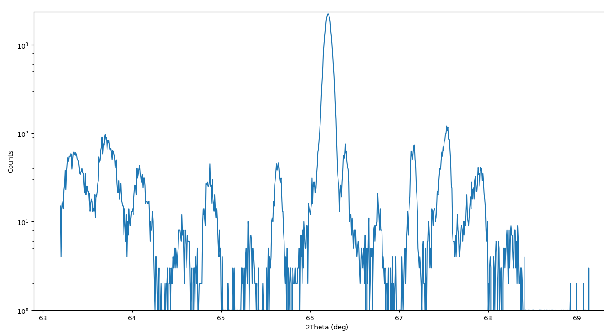
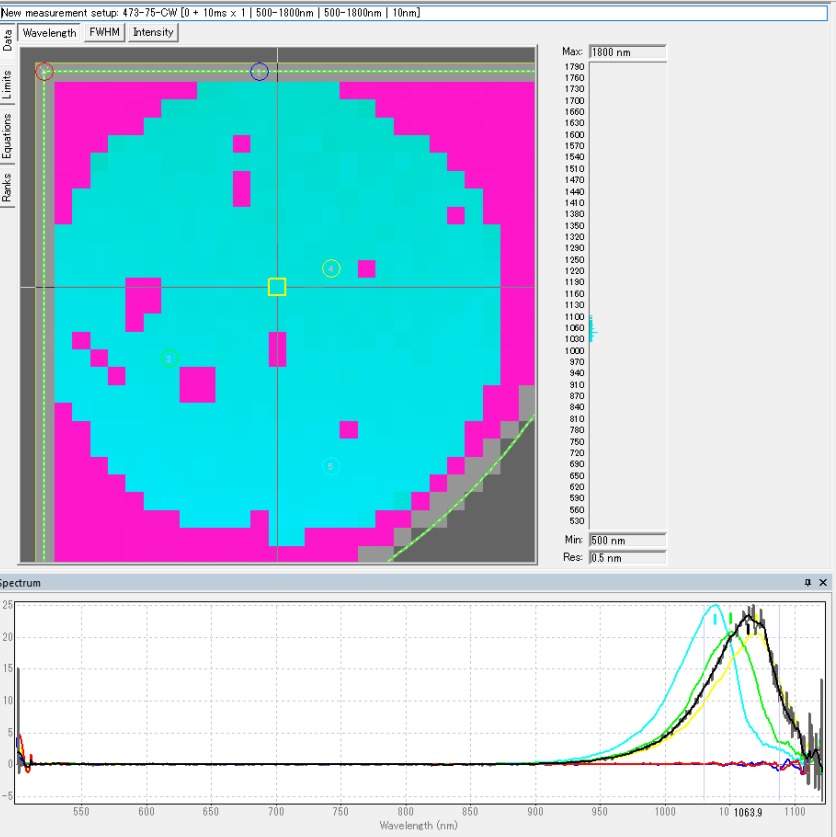
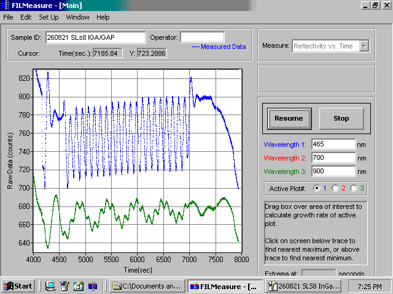

```{r setup, include=FALSE}
library(stringr)
library(ggplot2)
library(rmarkdown)
library(knitr)
library(readr)
```

```{r fig-options, include=FALSE}
base_dir <- "~/photin/krzyklo.github.io/" # i.e. where the jekyll blog is on the hard drive.
base_url <- "/" # keep as is

# If the document is currently being knit, do this; skip it in normal execution
if (!is.null(knitr::current_input())){

  # Output path for figures
  fig_path <- paste0("_site/assets/img/260923-InGaAs-GaAsP-superlattices/", str_remove(knitr::current_input(), ".Rmd"), "/")

  # Set base directories
  knitr::opts_knit$set(base.dir = base_dir, base.url = base_url)

  # Set figure directories
  knitr::opts_chunk$set(fig.path = fig_path,
                      cache.path = '../cache/',
                      message=FALSE, warning=FALSE,
                      cache = FALSE)
}

```

*K. Kłos ([Photin](https://www.photin.eu)), C. Rivera ([Waptel](https://waptel.es))*

InGaAs/GaAsP superlattices (SLs) are actively developed worldwide, as the number of their applications increases steadily [1]. The main idea is to take advantage of the mature GaAs platform, and extend the wavelength of edge lasers, VCSELs, LEDs, SOAs, modulators, detectors [2], solar cells, and power converters from 870nm up to ~1050nm-1100nm, to match with the YDF fiber amplifiers ecosystem and technology.

## Why InGaAs/GaAsP superlattices?

Mastering of InGaAs/GaAsP superlattices opens up high power, reliable Al-Free (ALFA) edge emitting lasers [3], which have enhanced lifetime/reliability, as they have higher thresholds for Catastrophic Optical Damage (COD) and for dark-line and dark-spot defects [4]. This kind of lasers is also suitable for implementing Buried Heterostructure designs, which require epitaxial regrowth [5]. Moreover, (Al,Ga,In)As-based structures cannot be epitaxially grown without undergoing relaxation, even at relatively low thicknesses.

Advantages of strain compensated InGaAs/GaAsP devices are well known to experts, and are subject to intensive research, such as DioHELIOS (Trumpf, ams-OSRAM, FBH, Jenoptik) to increase efficiency of high power lasers for nuclear fusion, or Al-Free lasers of Prof. Razeghi's CQD in the US.

## What was done

Photin studied the works of Hiromasa Fujii, who developed InGaAs/GaAs/GaAsP superlattice structures and provided many valuable insights about suitable setup and growth conditions [6]. Additional considerations were made regarding the accumulation of local elastic energy.

1. HR-XRD profile of the grown SLs structure is shown in Fig. 1,
2. PL map measurement of the wafer is shown in Fig. 2,
3. MOCVD process development was supported with Filmetrics reflectometer, which allowed to observe epitaxial growth in-situ (Fig. 3), tune growth parameters, and see their effects in real time.

```{r slsxrd, out.width="99%", fig.cap='Fig. 1. HR-XRD characteristic of SLs structure', fig.show='hold', echo=F, message = F, warning=F}

```

```{r slspl, out.width="70%", fig.cap='Fig. 2. PL measurement of SLs structure', fig.show='hold', echo=F, message = F, warning=F}

```

```{r slsreflectance, out.width="70%", fig.cap='Fig. 3. In-situ reflectance trace from 465nm and 900nm wavelength', fig.show='hold', echo=F, message = F, warning=F}

```

## Available for researchers worldwide

This kind of structures can now be ordered from Photin at affordable price by researchers worldwide, in 2" wafer size.
As far as we know, no other company or research institute in Poland demonstrated full PIN devices with technology of epitaxial growth of InGaAs/GaAsP superlattices so far.

## Funding

This research is part of the DEMOGAAS ("Development and fabrication of basic building blocks for advanced modulators on a GaAs platform") project, aiming to advance the development of an optoelectronic integrated circuit platform on GaAs, and has been partially funded by Spain Ministry of Industry and Tourism, under Order ITU/1144/2024, European Union Next Generation EU / PRTR.

## References

[1] R. Tribout et al., "High‐Detectivity InGaAs/GaAsP Superlattice PIN Photodetector with a Thin Absorber on GaAs substrate for 1100 nm Applications," Adv Elect Materials, vol. 12, no. 18, p. e70528, Sep. 2026, doi: [10.1002/aelm.70528](https://doi.org/10.1002/aelm.70528).
[2] V. Letka et al., "InGaAs/GaAsP Superlattice Resonant Cavity-Enhanced Photodetector Fabricated on a Nominal Si(001) Substrate for Near- and Short-Wavelength Infrared Applications," ACS Photonics, vol. 10, no. 9, pp. 3266–3274, Sep. 2023, doi: [10.1021/acsphotonics.3c00692](https://doi.org/10.1021/acsphotonics.3c00692).
[3] D. Botez, "Aluminum-free Technology Improves Diode Laser Performance." [Online]. Available: <https://www.photonicsonline.com/doc/aluminum-free-technology-improves-diode-laser-0001>
[4] M. M. Apter and A. Salokatve, "Diode Lasers: New materials promise extended life." [Online]. Available: <https://www.laserfocusworld.com/lasers-sources/article/16555708/diode-lasers-new-materials-promise-extended-life>
[5] R. Hogg, "III–V Epi advocates GaAs epi regrowth for emerging semiconductor laser applications." [Online]. Available: <https://www.semiconductor-today.com/news_items/2025/jan/iiivepi-270125.shtml>
[6] F. Hiromasa, "Design, Growth, and Characterization of InGaAs/GaAsP Superlattice for High Efficiency Ge-based Multi-junction Solar Cells," Mar. 24, 2015, University of Tokyo, doi: [10.15083/00008223](https://doi.org/10.15083/00008223).
